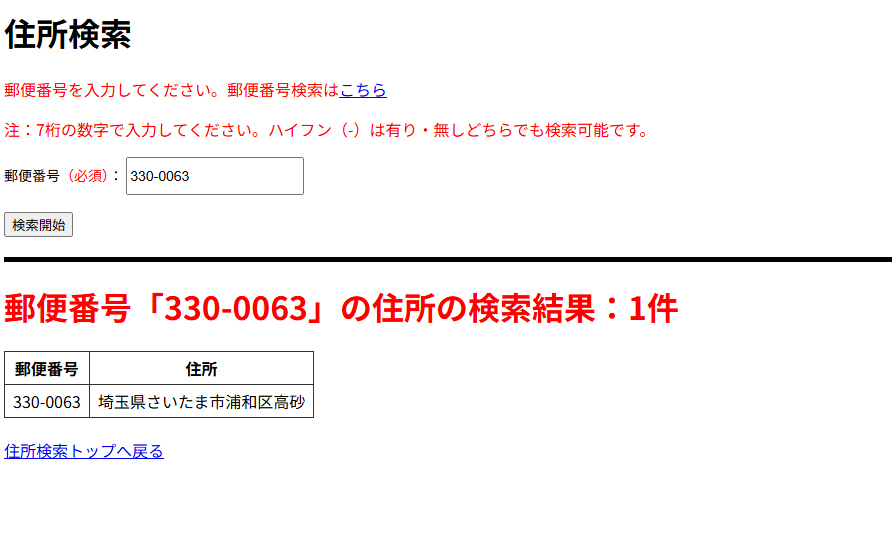
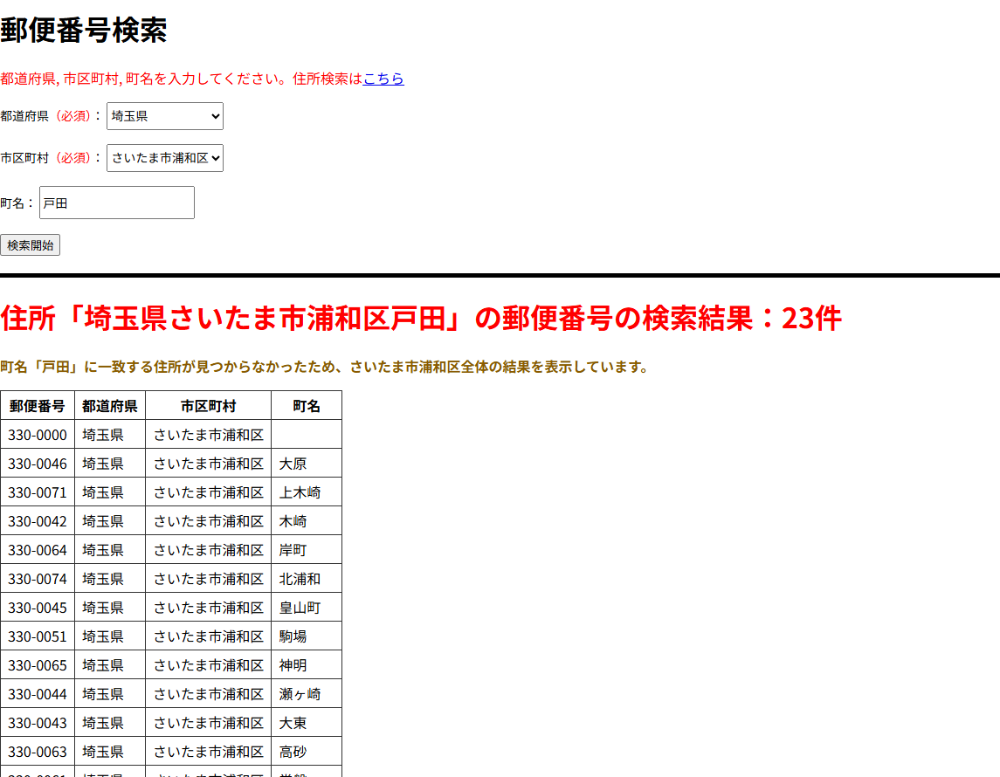
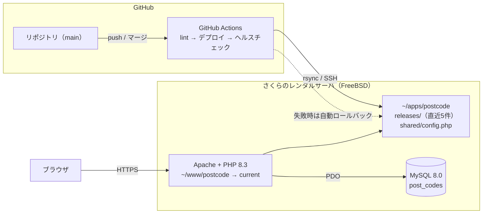
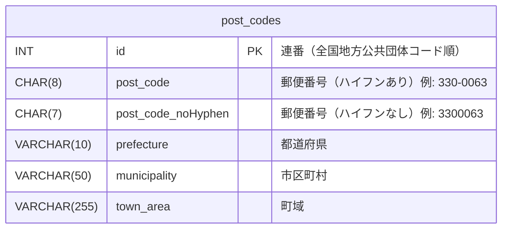

# 郵便番号・住所検索

[](https://github.com/KoichiKurita/Search_Address_and_PostCode/actions/workflows/deploy.yml)


日本郵便の郵便番号データ（約12万件）を使った、**郵便番号 → 住所** と **住所 → 郵便番号** の双方向検索ツールです。
フレームワークを使わずに PHP で作り、Docker での開発環境、GitHub Actions による自動デプロイ、GitHub の設定のコード化まで整えています。

**デモ:** https://graycow428.sakura.ne.jp/postcode/search_address.html

| 住所検索（郵便番号 → 住所） | 郵便番号検索（住所 → 郵便番号） |
|---|---|
|  |  |

---

## 機能

- **住所検索**：郵便番号から住所を検索する
  - `330-0063`・`3300063`・`330ー0063`（長音記号）・`３３０－００６３`（全角）など、入力の揺れを吸収する
- **郵便番号検索**：都道府県・市区町村・町名から郵便番号を検索する
  - 都道府県を選ぶと、市区町村の選択肢を非同期で読み込む
  - 町名で見つからない場合は、市区町村全体の結果を、そのことを知らせたうえで表示する
- 検索条件を結果画面に残すので、続けて検索できる

## 技術スタック

| 分類 | 使用技術 | 選んだ理由 |
|---|---|---|
| バックエンド | PHP 8.3（フレームワークなし）、PDO | 仕組みを理解するため、ルーティングや DB 接続を自分で書いている |
| フロントエンド | HTML / CSS / JavaScript（ES Modules） | ビルド不要で、ブラウザ標準の機能だけで動かす |
| データベース | MySQL 8.0 | 本番のレンタルサーバで使える DB に合わせている |
| 開発環境 | Docker Compose（PHP + MySQL + phpMyAdmin）、Make | `make init` だけで、本番と同じバージョンの環境が起動する |
| CI/CD | GitHub Actions、rsync over SSH | PR で構文チェック、`main` へのマージで本番へ自動デプロイ |
| 本番環境 | さくらのレンタルサーバ（FreeBSD） | 低コストで運用できる共用サーバ |
| プロジェクト管理 | GitHub Issues / Milestones / Rulesets（Python スクリプトで設定） | 設定を `project.json` で管理し、何度実行しても同じ状態にする |

## システム構成



### デプロイの流れ

`main` にマージすると、コミットごとのフォルダ（`releases/<コミットID>`）にアップロードしてから、公開用のシンボリックリンク `current` を一瞬で切り替えます。
切り替え後のヘルスチェックに失敗した場合は、直前のリリースへ自動で戻します。詳しくは [DEPLOY.md](DEPLOY.md) を参照してください。

## データベース



- インデックス：`post_code`、`post_code_noHyphen`、`(prefecture, municipality)`
- 文字コード：`utf8mb4` / 照合順序 `utf8mb4_bin`（全角・半角やカナの違いを区別して、完全一致で検索するため）

## 工夫した点

### 1. 入力の揺れを吸収する正規化
郵便番号の「ハイフン」には、全角ハイフン（－）、長音記号（ー）、マイナス記号（−）など、見た目が似た文字が多くあります。これらをまとめて半角の `-` にそろえ、全角数字も半角に変換しています。
漢数字の「一」も意図的に `-` として扱っています。日本語入力で「-」のつもりが「一」に変換されることがあり、郵便番号は数字だけなので、置き換えても困ることがないためです。
同じ正規化を **JS（送信前）と PHP（受信後）の両方**で行い、JS が動かない場合でも正しく検索できるようにしています。

### 2. 日本郵便データの変換スクリプト
日本郵便の CSV は、町域が長いと括弧の途中で複数行に分かれていたり、「以下に掲載がない場合」のような住所ではない注記が入っていたりします。
[`db/ken_all_to_sql.py`](db/ken_all_to_sql.py) で、分かれた行の結合と注記の除去を行い、phpMyAdmin のアップロード上限に収まる大きさの SQL ファイルに分けて出力しています。

### 3. セキュリティ
- SQL はすべてプリペアドステートメントで実行し、エミュレーションを無効にしている
- DB への書き込みを二重に防いでいる
  - 開発環境（Docker）：アプリは **SELECT だけの DB ユーザー**で接続し、データ投入には別のユーザーを使う
  - 本番：レンタルサーバでは権限を絞ったユーザーを作れない（`CREATE USER` / `GRANT` の権限がない）ため、接続直後に**セッションを読み取り専用**（`SET SESSION TRANSACTION READ ONLY`）にして、書き込み系の SQL を DB 側で拒否している
- HTML へのエスケープは**出力する場所で1回だけ**行う（JSON には生の値を入れ、JS 側は `textContent` / `new Option()` で扱う）
- DB エラーの詳細は画面に出さず、サーバーのログにだけ記録する
- DB の接続情報（`config.php`）は、Git に入れず、公開ディレクトリの外に置いている
- デプロイ用の SSH 鍵は専用のものを使い、`restrict` オプションでポート転送などを無効にしている
- `.htaccess` で、セキュリティヘッダ（CSP・HSTS など）を付け、設定ファイルや隠しファイルへのアクセスを拒否している

### 4. 止まらない・戻せるデプロイ
- シンボリックリンクの差し替えで公開先を切り替えるので、アップロード中の中途半端な状態が公開されない
- 本番が FreeBSD のため、デプロイスクリプトを POSIX sh だけで書き、CI でも `dash` で構文を確認している
- `main` ブランチの保護（PR 必須・CI 必須）と組み合わせて、構文エラーのあるコードが本番に出ないようにしている

### 5. 非同期処理の競合対策
都道府県をすばやく切り替えたとき、遅れて届いた古いリクエストの結果で市区町村の一覧が上書きされないように、リクエストに番号を付けて最新の結果だけを反映しています（[`js/municipality.js`](js/municipality.js)）。

## ディレクトリ構成

```
.
├── search_address.html        住所検索（入力画面）
├── result_address.php         住所検索（結果画面）
├── search_postcode.php        郵便番号検索（入力画面）
├── result_postcode.php        郵便番号検索（結果画面）
├── get_municipality.php       市区町村一覧を返す API（JSON）
├── functions.php              DB 接続・検索・入力の正規化
├── css/ js/                   スタイルと JavaScript（ES Modules）
├── db/                        テーブル定義、サンプルデータ、日本郵便データの変換スクリプト
├── docker/ docker-compose.yml ローカル開発環境
├── deploy/                    サーバー上で実行するデプロイスクリプト
├── scripts/github/            GitHub の設定（ラベル・Issue・ブランチ保護など）をコードで管理
└── .github/workflows/         CI/CD
```

## ローカルで動かす

必要なもの：Docker、Make、Git（Windows の場合は WSL2 の Ubuntu 上で実行）

```bash
git clone https://github.com/KoichiKurita/Search_Address_and_PostCode.git
cd Search_Address_and_PostCode
make init        # .env の作成 → ビルド → 起動（サンプルデータ入り）
```

http://localhost:8080/search_address.html を開き、`330-0063` で検索できれば起動完了です。

| コマンド | 内容 |
|---|---|
| `make seed-full` | 日本郵便の全国データ（約12万件）をダウンロードして投入する |
| `make lint` | PHP の構文チェック（CI と同じ内容） |
| `make tools` | phpMyAdmin を起動する（http://localhost:8081） |
| `make help` | コマンドの一覧 |

## ドキュメント

- [CONTRIBUTING.md](CONTRIBUTING.md)：ブランチ戦略、コミットの書き方、Issue から PR までの流れ
- [DEPLOY.md](DEPLOY.md)：自動デプロイの仕組みと、サーバー・GitHub の設定手順
- [MIGRATION.md](MIGRATION.md)：本番の DB の作成と、郵便番号データの投入手順

## 今後の予定

[マイルストーン](https://github.com/KoichiKurita/Search_Address_and_PostCode/milestones)で管理しています。

- **Phase 2**：サーバー側での入力値の検証、セキュリティヘッダ、DB ユーザーの最小権限化
- **Phase 3**：Composer、PHPUnit、PHPStan の導入と CI への組み込み、都道府県マスタによる高速化
- **Phase 4**：レイヤー分離（Repository・値オブジェクト）、JSON API、郵便番号データの月次自動更新

## データの出典

郵便番号データは、[日本郵便株式会社](https://www.post.japanpost.jp/zipcode/download.html)が公開している「住所の郵便番号（1レコード1行、UTF-8形式）」を使用しています。

## 作者

栗田 幸一（[@KoichiKurita](https://github.com/KoichiKurita)）
