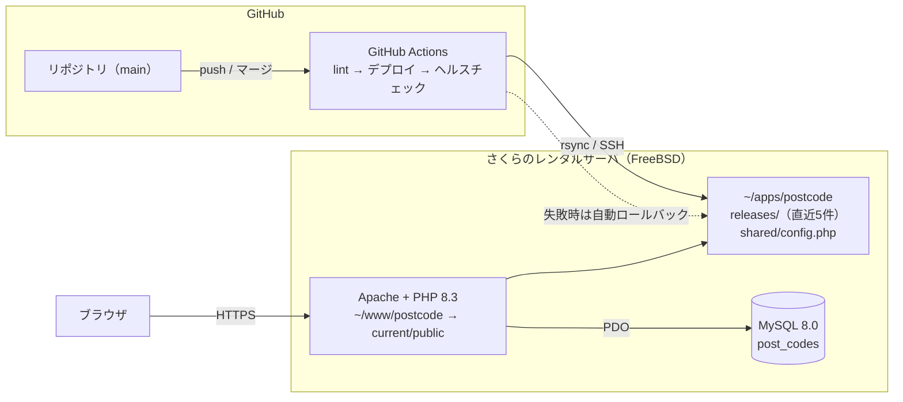

# 郵便番号・住所検索

[](https://github.com/KoichiKurita/Search_Address_and_PostCode/actions/workflows/deploy.yml)


日本郵便の郵便番号データ（約12万件）を使った、**郵便番号 → 住所** と **住所 → 郵便番号** の双方向検索ツールです。
フレームワークを使わずに PHP で作り、Docker での開発環境、GitHub Actions による自動デプロイ、GitHub の設定のコード化まで整えています。

**デモ:** https://graycow428.sakura.ne.jp/postcode/address

| 住所検索（郵便番号 → 住所） | 郵便番号検索（住所 → 郵便番号） |
|---|---|
|  |  |

---

## 機能

- **住所検索**：郵便番号から住所を検索する
  - 大口事業所・私書箱の**個別郵便番号**（例: `100-8792` 日本郵便株式会社）では、事業所名と番地までの住所を表示する
  - `330-0063`・`3300063`・`330ー0063`（長音記号）・`３３０－００６３`（全角）など、入力の揺れを吸収する
- **郵便番号検索**：都道府県・市区町村・町名から郵便番号を検索する
  - 町名は漢字でもフリガナでも検索できる（`たかさご`・`ﾀｶｻｺﾞ` のように、ひらがな・半角カナでもよい）
  - 都道府県を選ぶと、市区町村の選択肢を非同期で読み込む
  - 町名で見つからない場合は、市区町村全体の結果を、そのことを知らせたうえで表示する
- 検索条件を結果画面に残すので、続けて検索できる
- **JSON API**：郵便番号から住所を JSON で返す（ほかのサイトの JavaScript からも使える）
- **住所の自動入力デモ**（[`/autofill`](https://graycow428.sakura.ne.jp/postcode/autofill)）：郵便番号を入力すると、JSON API を使って住所の欄を埋める
  - 1つの郵便番号に複数の町域がある場合は、候補から選べる。候補が多いとき（例: `452-0961` は66件）は、町域の名前かフリガナで絞り込める
  - 住所のフリガナも入力する
  - 事業所の個別郵便番号（例: `100-8792`）では、番地まで入力する
  - 入力のたびに前の通信を `AbortController` で取り消し、古い結果で上書きされないようにしている

## API

### `GET /api/address?zip={郵便番号}`

郵便番号から住所を返します。`zip` は画面と同じく、ハイフンの有無・全角数字・各種ハイフンを吸収します。

```bash
curl "https://graycow428.sakura.ne.jp/postcode/api/address?zip=330-0063"
```

```json
{
  "zip": "330-0063",
  "count": 1,
  "addresses": [
    {
      "zip": "330-0063",
      "prefecture": "埼玉県",
      "municipality": "さいたま市浦和区",
      "town_area": "高砂",
      "full_address": "埼玉県さいたま市浦和区高砂",
      "prefecture_kana": "サイタマケン",
      "municipality_kana": "サイタマシウラワク",
      "town_area_kana": "タカサゴ",
      "full_address_kana": "サイタマケンサイタマシウラワクタカサゴ"
    }
  ],
  "offices": []
}
```

**事業所の個別郵便番号**（大口事業所・私書箱だけの郵便番号）の場合は、`offices` に入ります。
`count` は `addresses` の件数です（`offices` を追加する前からの意味を変えないため）。

```json
{
  "zip": "100-8792",
  "count": 0,
  "addresses": [],
  "offices": [
    {
      "zip": "100-8792",
      "name": "日本郵便株式会社",
      "name_kana": "ニツポンユウビンカブシキガイシヤ",
      "prefecture": "東京都",
      "municipality": "千代田区",
      "town_area": "大手町",
      "street": "２丁目３－１",
      "full_address": "東京都千代田区大手町２丁目３－１",
      "is_po_box": false
    }
  ]
}
```

| ステータス | 内容 |
|---|---|
| 200 | 成功。見つからない場合も 200 で `"count": 0`、`"addresses": []`、`"offices": []` |
| 400 | `zip` が無い、または7桁の数字でない。`{"error_msg": "..."}` |
| 405 | GET（HEAD）以外のメソッド |
| 500 | サーバー側のエラー（詳細はサーバーのログにだけ記録する） |

- **CORS**：`Access-Control-Allow-Origin: *` を付けているので、ほかのサイトの JavaScript から `fetch` で使えます。公開データを返すだけで、Cookie などは扱いません
- **キャッシュ**：`Cache-Control: public, max-age=3600`（1時間）を付けています。データは月に1回しか変わりませんが、長くしすぎると、データの更新や項目の追加がいつまでも届かないため、1時間にしています（以前の1日では、フリガナを追加したときに古い結果が使われ続けました）。エラーの応答はキャッシュさせません
- 共用のレンタルサーバで動かしているため、大量のリクエストは控えてください

## 技術スタック

| 分類 | 使用技術 | 選んだ理由 |
|---|---|---|
| バックエンド | PHP 8.3（フレームワークなし）、PDO | 仕組みを理解するため、ルーティングや DB 接続を自分で書いている |
| フロントエンド | HTML / CSS / JavaScript（ES Modules） | ビルド不要で、ブラウザ標準の機能だけで動かす |
| データベース | MySQL 8.0 | 本番のレンタルサーバで使える DB に合わせている |
| 開発環境 | Docker Compose（PHP + MySQL + phpMyAdmin）、Make | `make init` だけで、本番と同じバージョンの環境が起動する |
| テスト・静的解析 | PHPUnit 12、PHPStan（レベル max）、PHP-CS-Fixer（PSR-12） | 関数単体と DB の検索をテストし、型の誤りを実行前に見つけ、書き方をそろえる |
| CI/CD | GitHub Actions、rsync over SSH | PR で構文チェック・テスト・静的解析、すべて通ったものだけ `main` へのマージで本番へ自動デプロイ |
| 本番環境 | さくらのレンタルサーバ（FreeBSD） | 低コストで運用できる共用サーバ |
| プロジェクト管理 | GitHub Issues / Milestones / Rulesets（Python スクリプトで設定） | 設定を `project.json` で管理し、何度実行しても同じ状態にする |

## システム構成



### デプロイの流れ

`main` にマージすると、コミットごとのフォルダ（`releases/<コミットID>`）にアップロードしてから、公開用のシンボリックリンク `current` を一瞬で切り替えます。
切り替え後のヘルスチェックに失敗した場合は、直前のリリースへ自動で戻します。詳しくは [DEPLOY.md](DEPLOY.md) を参照してください。

## データベース

```mermaid
erDiagram
    post_codes {
        INT id PK "連番（全国地方公共団体コード順）"
        CHAR(8) post_code "郵便番号（ハイフンあり）例: 330-0063"
        CHAR(7) post_code_noHyphen "郵便番号（ハイフンなし）例: 3300063"
        VARCHAR(10) prefecture "都道府県"
        VARCHAR(50) municipality "市区町村"
        VARCHAR(1000) town_area "町域（最長297文字のものがある）"
        VARCHAR(20) prefecture_kana "都道府県のフリガナ"
        VARCHAR(100) municipality_kana "市区町村のフリガナ"
        VARCHAR(2000) town_area_kana "町域のフリガナ"
    }
    prefectures {
        INT id PK
        VARCHAR(10) name UK "都道府県"
        INT sort_order "並び順（post_codes の最小 id）"
    }
    municipalities {
        INT id PK
        INT prefecture_id FK
        VARCHAR(50) name "市区町村"
        INT sort_order "並び順（post_codes の最小 id）"
    }
    offices {
        INT id PK
        CHAR(7) post_code_noHyphen "事業所の個別郵便番号 例: 1008792"
        VARCHAR(100) name "事業所名"
        VARCHAR(100) name_kana "事業所名のフリガナ"
        VARCHAR(100) street "小字・丁目・番地など"
        TINYINT is_po_box "1: 私書箱 / 0: 大口事業所"
    }
    prefectures ||--o{ municipalities : "含む"
    prefectures ||..o{ post_codes : "集計元（refresh_masters.sql）"
````

- `prefectures` / `municipalities` は、プルダウンに出す一覧を `post_codes` から集計しておく**マスタテーブル**です。郵便番号データを取り込むたびに [`db/refresh_masters.sql`](db/refresh_masters.sql) で作り直します

- インデックス：`post_code`、`post_code_noHyphen`、`(prefecture, municipality)`
- 文字コード：`utf8mb4` / 照合順序 `utf8mb4_bin`（全角・半角やカナの違いを区別して、完全一致で検索するため）

## 工夫した点

### 1. 値オブジェクトと、入力の揺れを吸収する正規化
郵便番号は `App\Domain\PostalCode`（値オブジェクト）で表します。正しい郵便番号からしか作れないので、
検索のメソッド `findByPostalCode(PostalCode $postalCode)` には、**検証されていない文字列を型として渡せません**。
作られた時点で「ハイフンなしの7桁」に正規化されているので、ハイフンの有無で SQL を分ける必要もなくなりました。
DB の検索は Repository（`App\Domain\PostCodeRepository` と、その PDO による実装）にまとめ、検索結果は型の決まった `Address` オブジェクトで返します。
画面は SQL も配列のキーも知らずに `$address->prefecture` のように使えるため、PHPStan を最も厳しい **max レベル**にしても指摘は0件です。
郵便番号の「ハイフン」には、全角ハイフン（－）、長音記号（ー）、マイナス記号（−）など、見た目が似た文字が多くあります。これらをまとめて半角の `-` にそろえ、全角数字も半角に変換しています。
漢数字の「一」も意図的に `-` として扱っています。日本語入力で「-」のつもりが「一」に変換されることがあり、郵便番号は数字だけなので、置き換えても困ることがないためです。
同じ正規化を **JS（送信前）と PHP（受信後）の両方**で行い、JS が動かない場合でも正しく検索できるようにしています。

### 2. 日本郵便データの変換スクリプト
日本郵便の CSV は、町域が長いと括弧の途中で複数行に分かれていたり、「以下に掲載がない場合」のような住所ではない注記が入っていたりします。
[`db/ken_all_to_sql.py`](db/ken_all_to_sql.py) で、分かれた行の結合と注記の除去を行い、phpMyAdmin のアップロード上限に収まる大きさの SQL ファイルに分けて出力しています。

### 3. セキュリティ
- SQL はすべてプリペアドステートメントで実行し、エミュレーションを無効にしている
- DB への書き込みを二重に防いでいる
  - 開発環境（Docker）：アプリは **SELECT だけの DB ユーザー**で接続し、データ投入には別のユーザーを使う
  - 本番：レンタルサーバでは権限を絞ったユーザーを作れない（`CREATE USER` / `GRANT` の権限がない）ため、接続直後に**セッションを読み取り専用**（`SET SESSION TRANSACTION READ ONLY`）にして、書き込み系の SQL を DB 側で拒否している
- HTML へのエスケープは**出力する場所で1回だけ**行う（JSON には生の値を入れ、JS 側は `textContent` / `new Option()` で扱う）
- DB エラーの詳細は画面に出さず、サーバーのログにだけ記録する
- 公開するのは `public/`（フロントコントローラ・CSS・JS）だけにし、設定ファイル・ソースコード・`vendor/` は URL から開けない場所に置いている。デプロイ後のヘルスチェックでも、これらが見えないことを毎回確かめている
- DB の接続情報（`config.php`）は、Git に入れず、公開ディレクトリの外に置いている
- デプロイ用の SSH 鍵は専用のものを使い、`restrict` オプションでポート転送などを無効にしている
- `.htaccess` で、セキュリティヘッダ（CSP・HSTS など）を付け、設定ファイルや隠しファイルへのアクセスを拒否している（[securityheaders.com](https://securityheaders.com/) で A+ 評価）

### 4. 止まらない・戻せるデプロイ
- シンボリックリンクの差し替えで公開先を切り替えるので、アップロード中の中途半端な状態が公開されない
- 本番が FreeBSD のため、デプロイスクリプトを POSIX sh だけで書き、CI でも `dash` で構文を確認している
- `main` ブランチの保護（PR 必須・CI 必須）と組み合わせて、構文エラーのあるコードが本番に出ないようにしている

### 5. 計測にもとづく性能改善
都道府県のプルダウンは、以前は画面を開くたびに `post_codes`（124,527件）を `GROUP BY` で集計していました。
全国データと同じ件数のデータで `EXPLAIN ANALYZE` を取り、**12万行を毎回読んでいる**ことを確かめたうえで、一覧を集計済みのマスタテーブルに分けました。

| クエリ | 改善前 | 改善後 |
|---|---|---|
| 都道府県の一覧 | 124,527行を走査して集計（中央値 16.3ms） | 47行を読むだけ（中央値 **0.13ms**） |
| 市区町村の一覧（北海道・188件） | 一時テーブルで並べ替え（中央値 2.05ms） | インデックスの順に取り出すだけ（中央値 **0.32ms**） |

改善の前後で、一覧の内容と並び順が完全に一致することも確認しています。

### 6. フロントコントローラとテンプレート
以前は画面ごとに PHP ファイル（`search_address.html`・`result_address.php` など）があり、`<head>` や検索フォームを各ファイルにコピーしていました。
すべてのリクエストを `public/index.php` で受け、URL と処理の対応を [`Application`](src/Http/Application.php) の1か所にまとめました。

```
ブラウザ → public/index.php → Router → コントローラ → Repository（DB）
                                              └→ View → templates/（layout.php に各画面をはめ込む）
```

- コントローラは `echo` や `header()` を使わず、`Response` オブジェクトを返します。そのため **Web サーバーを起動しなくても**、URL ごとのステータスコード・ヘッダー・HTML を PHPUnit で確かめられます（`tests/Feature`）
- 入力画面と結果画面は同じフォームを表示していたので、1つの URL（`/address`・`/postcode`）にまとめました
- テンプレートの先頭に、受け取る変数の型を `@var` で書いているので、テンプレートの中も PHPStan（max）で検査されます
- 以前の URL は、クエリパラメータを引き継いで新しい URL へ移動させます（301。API は POST のまま送り直させる 308）

### 7. 郵便番号データの月次自動更新
日本郵便は毎月末日ごろに郵便番号データを更新します。GitHub Actions が毎月3日に最新の全件データをダウンロードし、本番の DB を入れ替えます（[`update-postcodes.yml`](.github/workflows/update-postcodes.yml)）。

```
GitHub Actions：ダウンロード → CSV に変換（ken_all_to_sql.py） → rsync で送る
サーバー：bin/import-postcodes.php … 全行を検証 → 件数を確認 → 1つのトランザクションで全件入れ替え → マスタを作り直す
```

- **差分ではなく全件を入れ替える**：日本郵便は差分データ（追加・廃止）も公開していますが、1回でも取り込みに失敗すると、その後ずっとずれたままになります。毎月全件を入れ替えれば、必ず最新のデータと一致します
- **取り込みの途中でも検索が止まらない**：「全件削除 → 全件追加」を1つのトランザクションで行うので、コミットするまで画面と API には古いデータが見えます。12万件の入れ替え中に、別の接続から件数を数え続けて、0件や途中の件数が一度も見えないことを確かめています
- **異常なデータを取り込まない**：先に CSV 全体を検証し（郵便番号の形・列の文字数）、件数が10万件未満、または今より5%以上減る場合は、DB に触れずに中止します。本番の MySQL は長すぎる値を黙って切り詰めるため、文字数はアプリ側で確かめています
- **書き込むのは取り込みだけ**：画面と API は読み取り専用のセッションのまま、取り込みのときだけ書き込みのできる接続を使います
- 追加・廃止された郵便番号の件数を、Actions のログに残します

### 8. 非同期処理の競合対策
都道府県をすばやく切り替えたとき、遅れて届いた古いリクエストの結果で市区町村の一覧が上書きされないように、リクエストに番号を付けて最新の結果だけを反映しています（[`js/municipality.js`](js/municipality.js)）。

## ディレクトリ構成

```
.
├── public/                    公開ルート（URL から見えるのはここだけ）
│   ├── index.php              フロントコントローラ（すべてのリクエストの入口）
│   ├── .htaccess              index.php への振り分け、HTTPS へのリダイレクト、セキュリティヘッダ
│   └── css/ js/               スタイルと JavaScript（ES Modules）
├── src/
│   ├── Http/                  リクエスト・レスポンス・ルーター・テンプレートの表示、URL の対応表（Application）
│   ├── Controller/            画面と API の処理（住所検索・郵便番号検索・市区町村 API）
│   ├── Domain/                値オブジェクト（PostalCode・Address）と Repository のインターフェース
│   ├── Infrastructure/        Repository の実装（PDO。SQL はここだけ）
│   └── helpers.php            画面で使う小さな関数（エスケープ・ページングの計算など）
├── templates/                 HTML のテンプレート（共通レイアウト・各画面・エラーページ）
├── bin/                       コマンド（郵便番号データの取り込み）
├── bootstrap.php              設定・オートローダーの読み込みと DB 接続
├── tests/                     PHPUnit のテスト（Unit: 関数・クラス単体、Integration: DB の検索、Feature: URL ごとの画面・API）
├── db/                        テーブル定義、サンプルデータ、日本郵便データの変換スクリプト
├── docker/ docker-compose.yml ローカル開発環境
├── deploy/                    サーバー上で実行するデプロイスクリプト
├── scripts/github/            GitHub の設定（ラベル・Issue・ブランチ保護など）をコードで管理
└── .github/workflows/         CI/CD
```

## ローカルで動かす

必要なもの：Docker、Make、Git（Windows の場合は WSL2 の Ubuntu 上で実行）

```bash
git clone https://github.com/KoichiKurita/Search_Address_and_PostCode.git
cd Search_Address_and_PostCode
make init        # .env の作成 → ビルド → 起動（サンプルデータ入り）
```

http://localhost:8080/address を開き、`330-0063` で検索できれば起動完了です。

| コマンド | 内容 |
|---|---|
| `make seed-full` | 日本郵便の全国データ（住所 約12万件・事業所 約2万件）をダウンロードして投入する（本番の月次更新と同じ手順） |
| `make import CSV=…` | 変換済みの CSV を DB に取り込む（事業所は `OFFICES=1` を付ける） |
| `make build` | Docker のイメージを作り直す（Dockerfile を変えたとき） |
| `make lint` | PHP の構文チェック（CI と同じ内容） |
| `make composer-install` | Composer で PHPUnit などをインストールする（初回のみ） |
| `make test` | PHPUnit でテストを実行する |
| `make stan` | PHPStan で静的解析する（レベル max） |
| `make fmt` | PHP-CS-Fixer でコードを整形する（PSR-12） |
| `make tools` | phpMyAdmin を起動する（http://localhost:8081） |
| `make help` | コマンドの一覧 |

## ドキュメント

- [CONTRIBUTING.md](CONTRIBUTING.md)：ブランチ戦略、コミットの書き方、Issue から PR までの流れ
- [DEPLOY.md](DEPLOY.md)：自動デプロイの仕組みと、サーバー・GitHub の設定手順
- [MIGRATION.md](MIGRATION.md)：本番の DB の作成と、郵便番号データの投入手順

## 今後の予定

[マイルストーン](https://github.com/KoichiKurita/Search_Address_and_PostCode/milestones)で管理しています。

- **Phase 2**：サーバー側での入力値の検証、セキュリティヘッダ、DB ユーザーの最小権限化
- **Phase 3**：Composer、PHPUnit、PHPStan の導入と CI への組み込み、都道府県マスタによる高速化
- **Phase 4**：レイヤー分離（Repository・値オブジェクト）、JSON API、郵便番号データの月次自動更新
- **Phase 5**：フリガナでの検索、事業所の個別郵便番号、自動入力デモの改善

## データの出典

郵便番号データは、[日本郵便株式会社](https://www.post.japanpost.jp/zipcode/download.html)が公開している「住所の郵便番号（1レコード1行、UTF-8形式）」と「事業所の個別郵便番号」を使用しています。

## 作者

栗田 幸一（[@KoichiKurita](https://github.com/KoichiKurita)）
